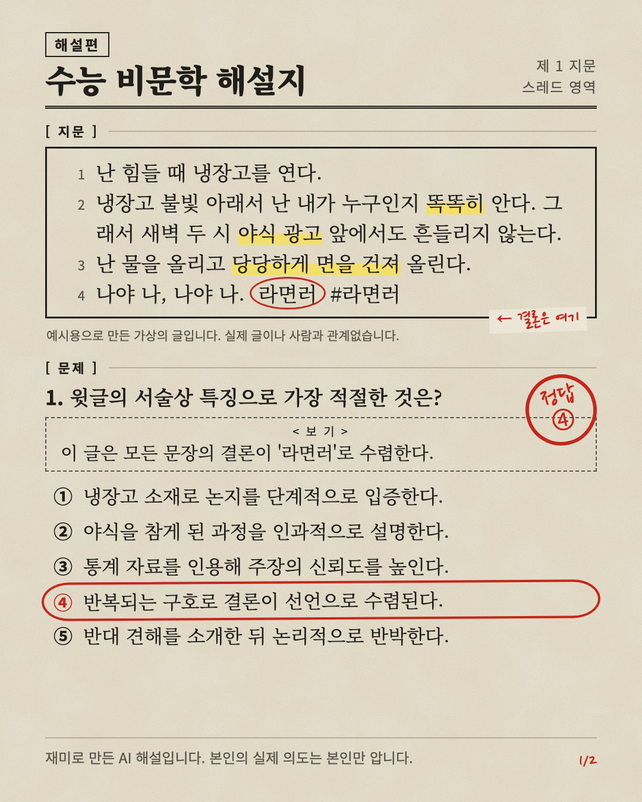
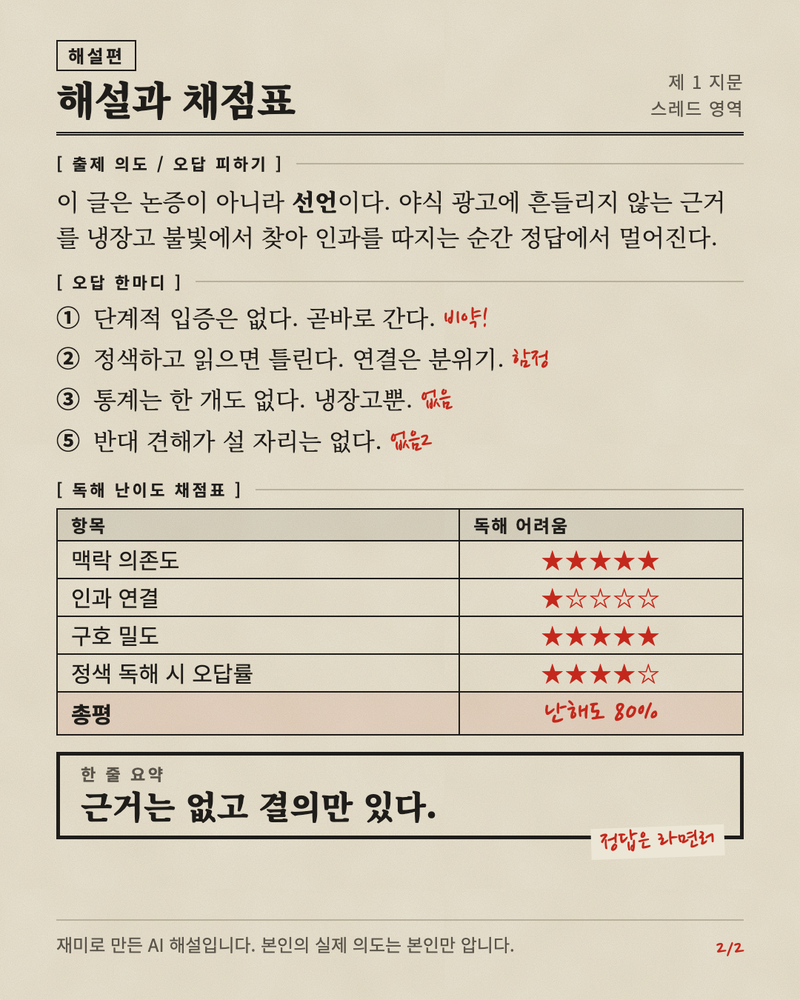
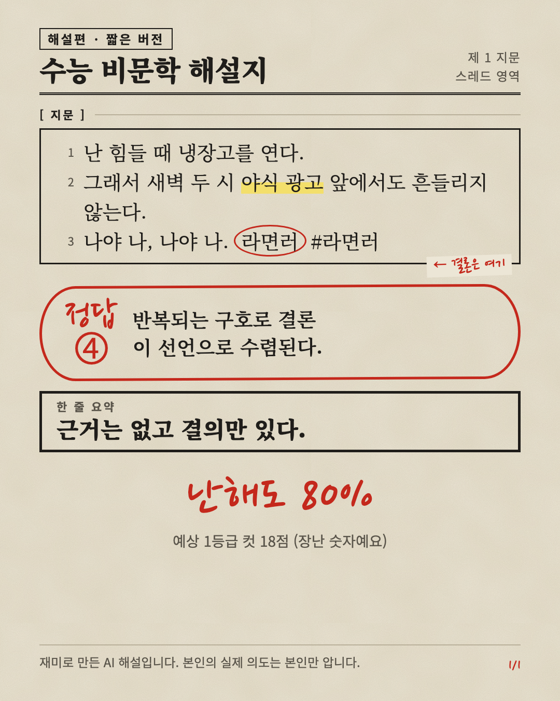

# suneung-haeseol · Explain any post like a Korean exam answer key

**English** | [한국어](README.md) | [日本語](README.ja.md) | [简体中文](README.zh-CN.md)

Some posts are really hard to understand. This skill takes one and turns it into a deadpan exam answer key: an excerpt, a multiple-choice question with the right answer circled in red pen, a "why the other options are wrong" explanation, and a difficulty scorecard.
**The joke is how hard the text is to read. It is never the person who wrote it.**

> ### No coding needed. Just tell Claude:
> **"Install skills/suneung-haeseol from github.com/gonipro/suneung-haeseol into my skills (~/.claude/skills), then explain this post like a Korean exam reading passage."**
>
> Then paste the post.

---

## What you get

 

Two cards in 4:5 (1080×1350), made to screenshot and post on Threads: one for the question, one for the explanation and scorecard. The text is a made-up post. The red-pen paper look appears where the AI can show a web page. Everywhere else you get the same sections as plain text.

**Need something shorter for a comment?** Ask for the **short version**: one card with the passage, the correct answer, a one-line summary and the difficulty.

## What is "수능 (suneung)"?

It is Korea's college entrance exam. Its reading section is famous for long, solemn explanations of short passages ("The author is expressing…"). This skill borrows that straight-faced tone and aims it at confusing posts.

## Who is it for?

- You read a post and think "what does this even mean?"
- You are a fan who wants to explain a hard-to-read post to friends
- You want a funny thread idea that takes 30 seconds

## Two ways to use it

### 1. Try it without installing (easiest)
1. Open [PROMPT.en.md](PROMPT.en.md) and copy everything in it.
2. Paste it into the AI you already use (Claude, ChatGPT, Gemini).
3. Paste the post you want explained and send.

### 2. Use it as a Claude Code skill
Tell Claude:
> "Install skills/suneung-haeseol from github.com/gonipro/suneung-haeseol into my skills (~/.claude/skills), then explain this post like a Korean exam reading passage."

### Other languages
The prompt also comes in [한국어](PROMPT.md), [日本語](PROMPT.ja.md) and [简体中文](PROMPT.zh-CN.md). The AI answers in the language you write in.

## How the answer key is built

| Step | What it does |
|---|---|
| 1. Passage | Quotes a few lines of the post as they are (no name, no account) |
| 2. Writing habits | Notes only what you can see: sentence length, endings, "I" count, repeated words |
| 3. Question | One multiple-choice question with a `<Note>` line. One right answer, four tempting wrong ones |
| 4. Explanation | Summary, "what the exam is really testing", and one remark per wrong option |
| 5. Difficulty scorecard | Four star ratings and a total like "difficulty 80%" |
| 6. One-line summary | One sentence |
| 7. Paste block | 3 to 4 lines you can post right away |

### Scorecard example (made-up post)

| Item | Difficulty to read | Note |
|---|---|---|
| Needs outside context | ★★★★★ | Easy if you know, lost if you don't |
| Cause and effect | ★☆☆☆☆ | The link is a mood |
| Slogan density | ★★★★★ | Packed into the last line |
| Wrong-answer rate if read seriously | ★★★★☆ | The more serious, the worse |
| **Total** | **Difficulty 80%** | Skip unreadable parts coolly |

## Good to know

- **It can't open my link.** Many AIs can't read links. Paste the text of the post instead. That always works.
- **No red-pen picture appears.** Chat apps that can't show a web page give you the same sections as text. That is normal.
- **Can I use it on someone's real post?** Public posts only, for fun only. Never to put someone down.

## What it will not do

- It makes fun of how hard the text is to read, not of the writer.
- It does not invent facts. No job, family, past or inner feelings that the post does not say.
- It skips family, death and loss, tears, health, looks, sexual content, and minors.
- The percentage is a joke about the text. It does not rate anyone's sincerity.
- It does not diagnose a whole account's personality or values.
- Every result ends with: "A fun AI explanation. Only the writer knows what they really meant."

---

Made by [GoniPro](https://gonipro.app) · MIT
