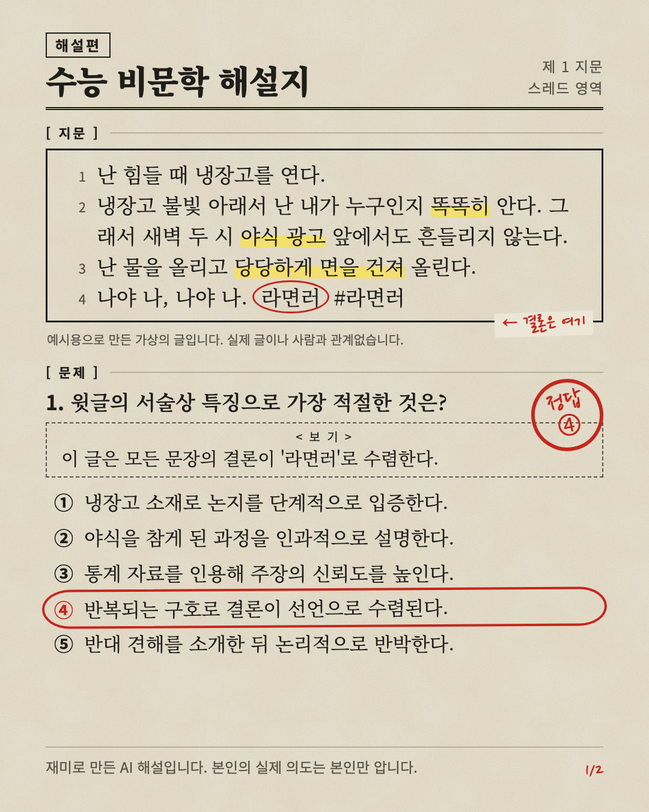
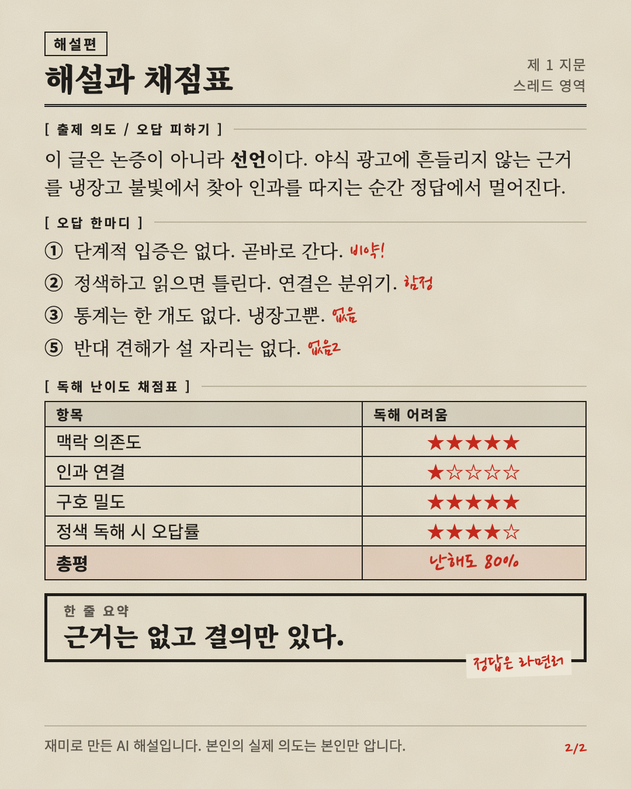
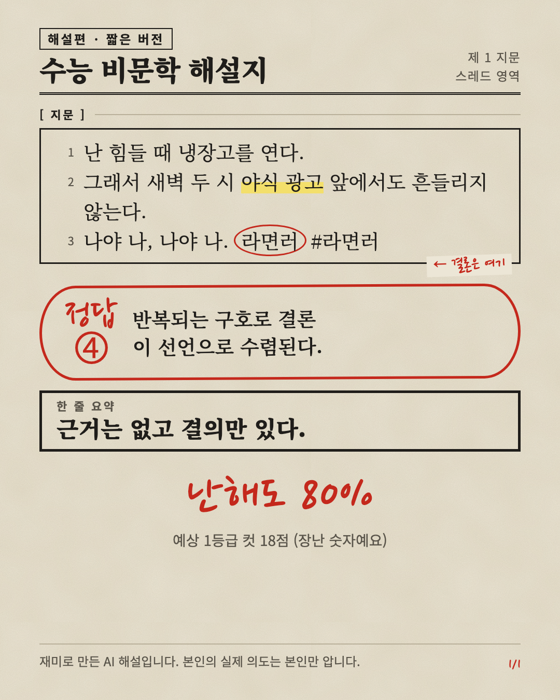

# suneung-haeseol · 投稿を「修能(スヌン)読解の解説」風に

[English](README.en.md) | [한국어](README.md) | **日本語** | [简体中文](README.zh-CN.md)

読んでいて「これ、どういう意味?」となる投稿があります。このスキルは、そんな投稿を**韓国の大学入試(修能)の読解問題の解答解説**のように、真面目な顔で面白く解説します。
本文の抜粋、正解に赤ペンで丸がついた問題、不正解の解説、読解の難易度スコアカードまで出ます。
**笑いのネタは「文章が読みにくいこと」です。書いた人ではありません。**

> ### プログラミングの知識は不要です。Claudeにこう伝えるだけ
> **「github.com/gonipro/suneung-haeseol の skills/suneung-haeseol を私のスキル(~/.claude/skills)にインストールして、この投稿を修能の読解問題のように解説して」**
>
> そのあと、解説してほしい投稿を貼り付けてください。

---

## こんな風に出ます

 

スレッドに**スクリーンショットで投稿しやすい**4:5のカード2枚(1080×1350)で出ます。1枚は問題、1枚は解説とスコアカードです。画像の文章は、こちらで作った架空の投稿です。赤ペンの紙の見た目は、AIがウェブ画面を表示できる環境で出ます。それ以外では同じ項目が文章で出ます。

**コメント用に短くしたい?** 「短く」と頼むと**短いバージョン**が1枚出ます。本文、正解、一行要約、難解度だけが入ります。

## 修能(スヌン)とは?

韓国の大学入試です。国語の読解は、短い文章に対して「筆者は〜を表現している」と長く真面目に解説することで有名です。このスキルはその真顔のトーンを借りて、分かりにくい投稿に当てます。

## こんな方に

- 投稿を読んで「どういう意味?」と思ったことがある
- 読みにくい投稿を友だちに面白く説明したい
- 30秒で面白いスレッドのネタが欲しい

## 使い方は2つ

### 1. インストールなしで試す(いちばん簡単)
1. [PROMPT.ja.md](PROMPT.ja.md) を開いて、中身をすべてコピーします。
2. いつも使っているAI(Claude・ChatGPT・Gemini)に貼り付けます。
3. 解説してほしい投稿を続けて貼り付けて送信します。

### 2. Claude Code のスキルとして使う
Claudeにこう伝えてください。
> 「github.com/gonipro/suneung-haeseol の skills/suneung-haeseol を私のスキル(~/.claude/skills)にインストールして、この投稿を修能の読解問題のように解説して」

## 解説はこうできています

| 順番 | 内容 |
|---|---|
| 1. 本文 | 投稿の数行をそのまま引用(名前・アカウントは出しません) |
| 2. 書き癖の観察 | 見えることだけ。文の長さ、語尾、「私」の回数、繰り返される言葉 |
| 3. 問題 | <ボックス>の一行と5択を1問。正解は1つ、もっともらしい不正解が4つ |
| 4. 解説 | 要約、出題の意図、不正解ごとのひとこと |
| 5. 読解難易度スコアカード | 星4項目と「難解度 N%」の総評 |
| 6. 一行要約 | 一文 |
| 7. 貼り付け用 | そのまま投稿できる3〜4行 |

### スコアカードの例(架空の投稿)

| 項目 | 読みにくさ | メモ |
|---|---|---|
| 文脈への依存 | ★★★★★ | 知っていれば簡単、知らなければお手上げ |
| 因果のつながり | ★☆☆☆☆ | つながりは雰囲気 |
| スローガン密度 | ★★★★★ | 最後の行に集中 |
| 真面目に読んだときの誤答率 | ★★★★☆ | 真面目なほど危険 |
| **総評** | **難解度 80%** | 読めない部分はクールに流すこと |

## 知っておいてください

- **リンクが開けないと言われた。** リンクを読めないAIは多いです。投稿の文章を直接貼り付ければ、いつでも使えます。
- **赤ペンの画像が出ない。** ウェブ画面を表示できないチャットでは、同じ項目が文章で出ます。正常です。
- **他の人の投稿に使っていい?** 公開されている投稿だけ、楽しむ目的だけで使ってください。人を貶めるためには使わないでください。

## しないこと

- 笑いの対象は文章の読みにくさです。書いた人ではありません。
- 投稿にない事実は作りません。職業・家族・過去・内心を決めつけません。
- 家族、死や喪失、涙、健康、容姿、性的な内容、未成年は笑いの種にしません。
- パーセントは文章についての冗談です。誰かの本気度を測るものではありません。
- アカウント全体の性格や価値観を診断しません。
- 結果の最後に必ず次の一行が付きます:「楽しみで作ったAIの解説です。本人の本当の意図は本人だけが知っています。」

---

制作: [GoniPro](https://gonipro.app) · MIT
