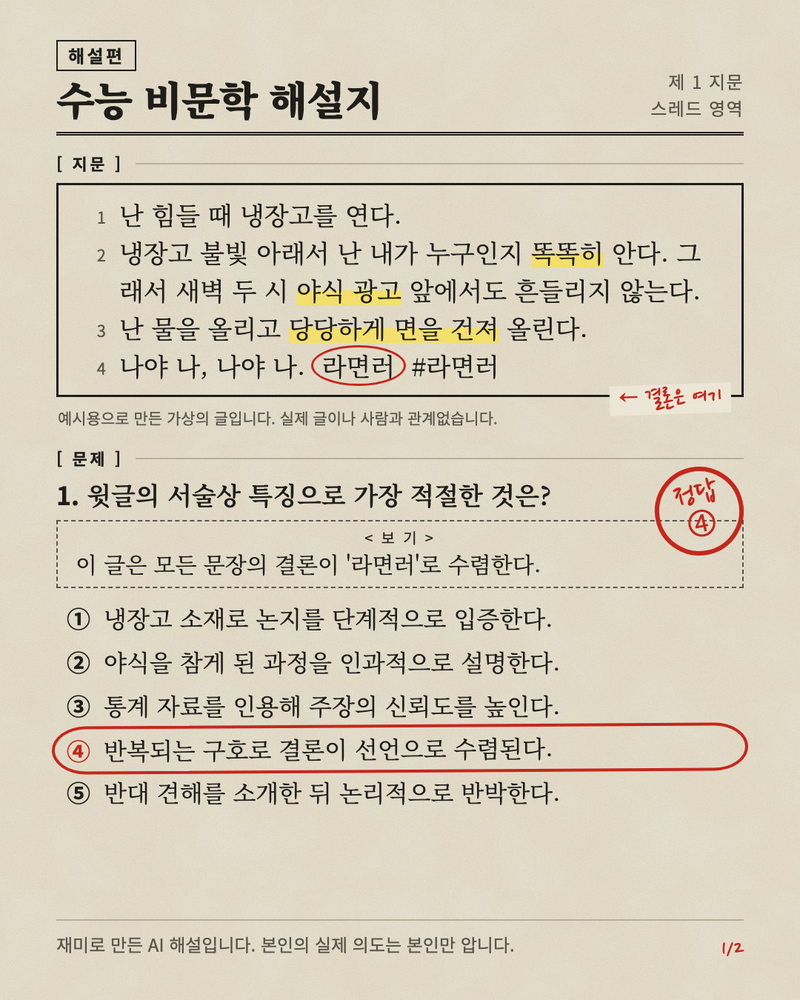
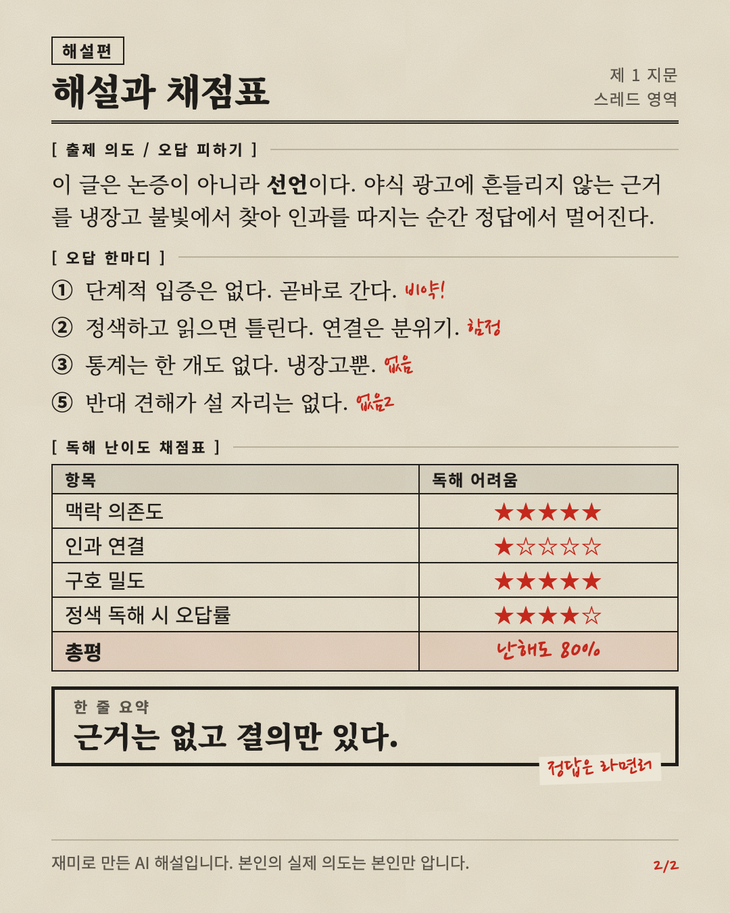
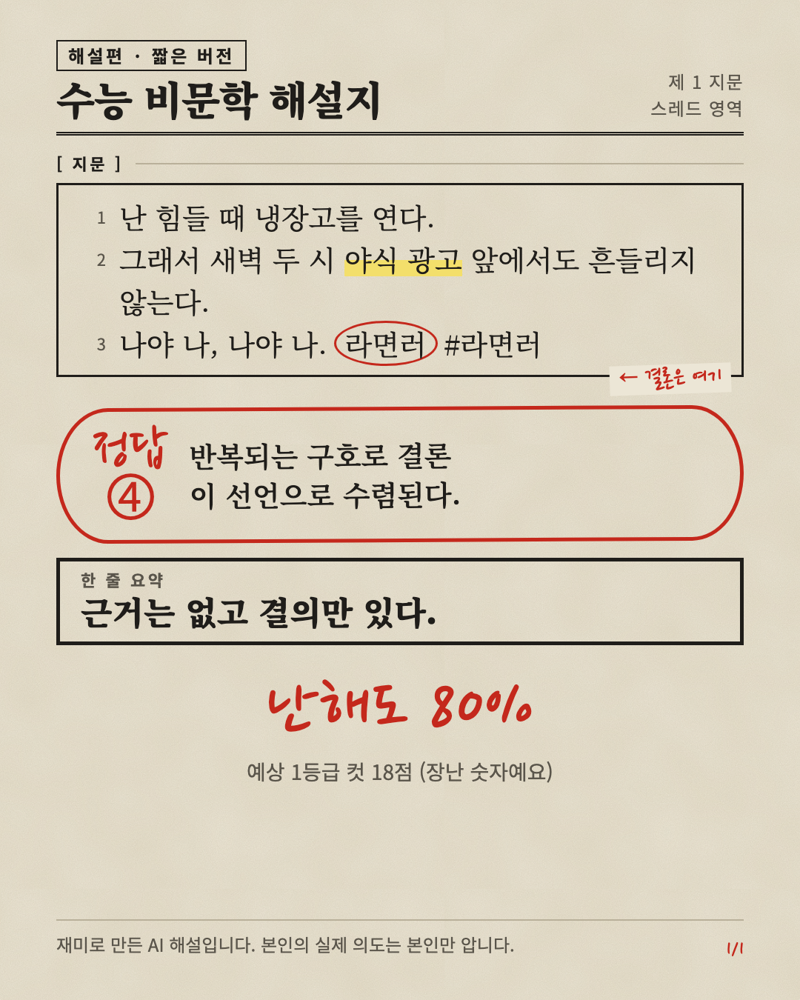

# suneung-haeseol · 스레드 글을 수능 비문학 해설지처럼

[English](README.en.md) | **한국어** | [日本語](README.ja.md) | [简体中文](README.zh-CN.md)

읽다 보면 "이게 무슨 말이지?" 싶은 글이 있어요. 이 스킬은 그런 글을 넣으면 **수능 비문학 해설지**처럼 진지한 척 웃기게 풀어 줘요.
지문 발췌, 정답에 빨간 동그라미가 쳐진 문제, 오답 해설, 독해 난이도 채점표까지 나와요.
**웃기는 건 글이 읽기 어렵다는 점이에요. 글쓴이가 아니에요.**

> ### 개발 몰라도 돼요. 클로드에게 이렇게만 말하세요
> **"github.com/gonipro/suneung-haeseol 의 skills/suneung-haeseol 을 내 스킬(~/.claude/skills)에 설치하고, 이 글 수능 비문학처럼 해석해 줘"**
>
> 그다음 해석하고 싶은 글을 붙여 넣으면 돼요.

---

## 이렇게 나와요

 

스레드에 **캡처해서 올리기 좋게** 4:5 카드 2장(1080×1350)으로 나와요. 한 장은 문제, 한 장은 해설과 채점표예요. 그림 속 글은 제가 만든 가상의 글이에요. 빨간펜 종이 모양은 AI가 웹 화면을 보여 줄 수 있는 곳에서 나와요. 그렇지 않은 곳에서는 같은 칸이 글로 나와요.

**댓글에 짧게 달고 싶다면?** "짧게"라고 말하면 **짧은 버전** 1장이 나와요. 지문, 정답, 한 줄 요약, 난해도만 들어 있어요.

## 이런 분께 좋아요

- 글을 읽다가 "이게 무슨 뜻이지?" 싶었던 분
- 어려운 글을 친구에게 웃기게 설명해 주고 싶은 분
- 30초 만에 웃긴 스레드 소재가 필요한 분

## 쓰는 법 두 가지

### 1. 설치 없이 바로 해 보기 (제일 쉬워요)
1. [PROMPT.md](PROMPT.md)를 열고 안의 내용을 전부 복사해요.
2. 자주 쓰는 AI(클로드·챗GPT·제미나이)에 붙여 넣어요.
3. 해석하고 싶은 글을 이어서 붙여 넣고 보내요.

### 2. 클로드 코드 스킬로 쓰기
클로드에게 이렇게 말하세요.
> "github.com/gonipro/suneung-haeseol 의 skills/suneung-haeseol 을 내 스킬(~/.claude/skills)에 설치하고, 이 글 수능 비문학처럼 해석해 줘"

## 해설지는 이렇게 만들어져요

| 순서 | 하는 일 |
|---|---|
| 1. 지문 | 글에서 몇 줄만 그대로 인용해요 (이름·계정은 빼요) |
| 2. 말버릇 관찰 | 눈에 보이는 것만요. 문장 길이, 끝맺음, "나" 횟수, 반복 단어 |
| 3. 문제 | <보기> 한 줄과 5지선다 1개. 정답 하나, 그럴듯한 오답 넷 |
| 4. 해설 | 문단 요약, 출제 의도·오답 피하기, 오답별 한마디 |
| 5. 독해 난이도 채점표 | 별점 4개와 "난해도 N%" 총평 |
| 6. 한 줄 요약 | 한 문장 |
| 7. 스레드에 붙이기 | 바로 올릴 수 있는 3~4줄 |

### 채점표 예시 (가상의 글)

| 항목 | 독해 어려움 | 비고 |
|---|---|---|
| 맥락 의존도 | ★★★★★ | 알면 쉽고 모르면 끝 |
| 인과 연결 | ★☆☆☆☆ | 연결 고리는 분위기 |
| 구호 밀도 | ★★★★★ | 마지막 줄에 집중 |
| 정색 독해 시 오답률 | ★★★★☆ | 진지할수록 위험 |
| **총평** | **난해도 80%** | 해석 불가 구간은 쿨하게 넘길 것 |

## 알아 두세요

- **링크가 안 열린대요.** 링크를 못 읽는 AI가 많아요. 글 내용을 직접 붙여 넣으면 항상 돼요.
- **빨간펜 그림이 안 나와요.** 웹 화면을 못 보여 주는 채팅에서는 같은 칸이 글로 나와요. 정상이에요.
- **다른 사람이 쓴 글에 써도 되나요?** 공개된 글만, 재미로만 써요. 사람을 깎아내리는 데 쓰지 마세요.

## 하지 않는 것

- 웃기는 건 글의 난해함이에요. 글쓴이가 아니에요.
- 글에 없는 사실을 만들지 않아요. 직업·가족·과거·속마음을 단정하지 않아요.
- 가족, 죽음·상실, 눈물, 건강, 외모, 성적 내용, 미성년자는 웃음거리로 쓰지 않아요.
- 퍼센트는 글에 대한 장난이에요. 누구의 진심도 재지 않아요.
- 계정 전체의 성격이나 가치관을 진단하지 않아요.
- 결과 맨 아래에 꼭 이 한 줄이 붙어요: "재미로 만든 AI 해설입니다. 본인의 실제 의도는 본인만 압니다."

---

만든 곳: [GoniPro](https://gonipro.app) · MIT
