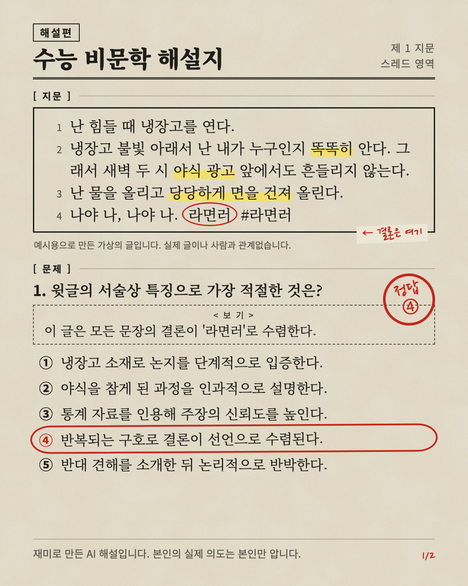
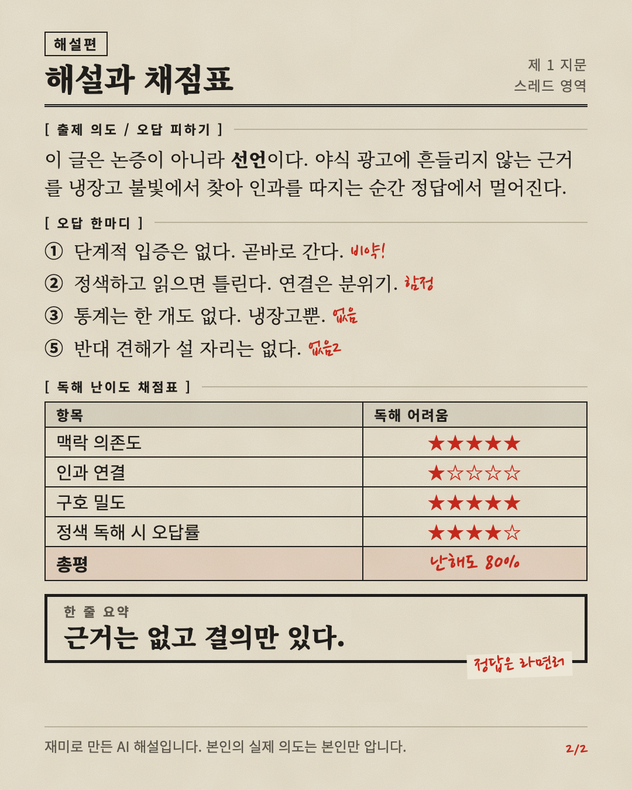
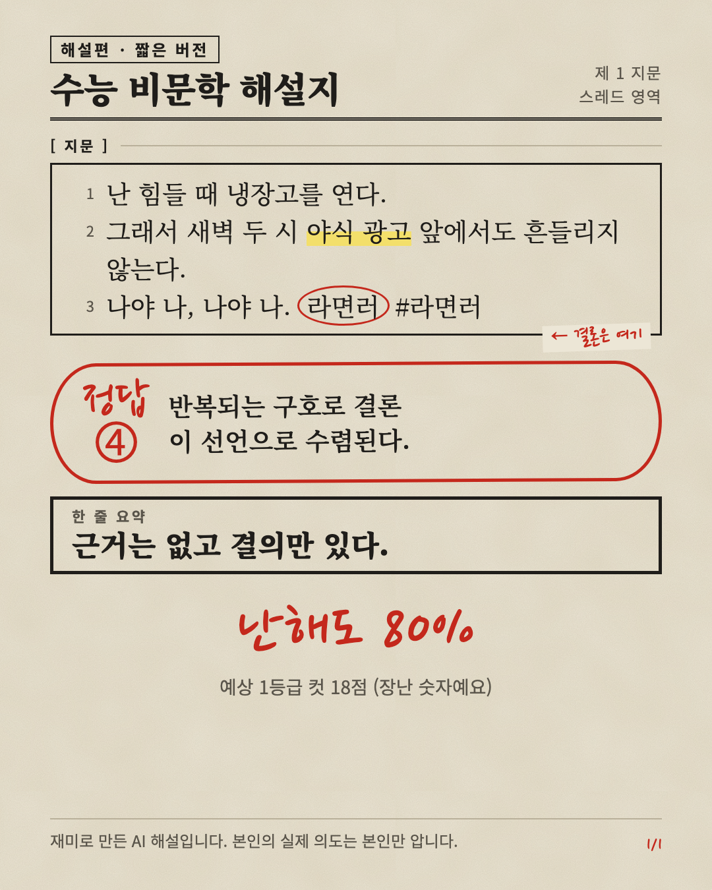

# suneung-haeseol · 把帖子写成「高考(修能)阅读题」解析

[English](README.en.md) | [한국어](README.md) | [日本語](README.ja.md) | **简体中文**

有些帖子读着读着会想:"这到底是什么意思?"这个技能会把它变成一份**韩国高考(修能)阅读理解的答案解析**,一本正经,却很好笑。
会有原文节选、正确答案被红笔圈起来的选择题、错误选项解析,以及阅读难度评分表。
**好笑的是文字难懂,而不是写帖子的人。**

> ### 不需要懂编程。只要对 Claude 说:
> **"把 github.com/gonipro/suneung-haeseol 里的 skills/suneung-haeseol 安装到我的技能目录(~/.claude/skills),然后把这条帖子写成韩国高考阅读题的解析。"**
>
> 然后把想解析的帖子粘贴进去。

---

## 效果长这样

 

为了方便**截图发到串文(Threads)**,会生成 4:5 的卡片 2 张(1080×1350):一张是题目,一张是解析和评分表。图中的文字是我们编的虚构帖子。红笔纸张的外观会出现在 AI 能显示网页的环境里,其他环境会用文字给出同样的栏目。

**想在评论里发短一点的?** 说一声"短版",就会生成**短版**卡片 1 张,只包含原文、正确答案、一句话总结和难懂度。

## 什么是"修能(suneung)"?

韩国的大学入学考试。它的阅读部分以"作者通过……表达了……"这种又长又严肃的解析闻名。这个技能借用这种一本正经的语气,用来解读让人看不懂的帖子。

## 适合谁

- 读帖子时想过"这到底什么意思"
- 想把难懂的帖子有趣地讲给朋友听
- 想用 30 秒做出一条有趣的串文

## 两种用法

### 1. 不安装,直接试(最简单)
1. 打开 [PROMPT.zh-CN.md](PROMPT.zh-CN.md),复制里面的全部内容。
2. 粘贴到你常用的 AI(Claude、ChatGPT、Gemini)。
3. 接着粘贴想解析的帖子并发送。

### 2. 作为 Claude Code 技能使用
对 Claude 说:
> "把 github.com/gonipro/suneung-haeseol 里的 skills/suneung-haeseol 安装到我的技能目录(~/.claude/skills),然后把这条帖子写成韩国高考阅读题的解析。"

## 解析是这样做出来的

| 步骤 | 内容 |
|---|---|
| 1. 原文 | 原样引用帖子里的几行(不写名字和账号) |
| 2. 写作习惯观察 | 只写看得见的:句子长度、结尾方式、"我"的次数、重复的词 |
| 3. 题目 | 一条<提示>加一道五选一。一个正确答案,四个看似合理的错误选项 |
| 4. 解析 | 段落概述、出题意图、每个错误选项的一句话点评 |
| 5. 阅读难度评分表 | 四项星级和"难懂度 N%"的总评 |
| 6. 一句话总结 | 一句话 |
| 7. 粘贴用文案 | 可以直接发布的 3 到 4 行 |

### 评分表示例(虚构帖子)

| 项目 | 阅读难度 | 备注 |
|---|---|---|
| 依赖背景知识 | ★★★★★ | 知道就简单,不知道就完了 |
| 因果联系 | ★☆☆☆☆ | 联系靠气氛 |
| 口号密度 | ★★★★★ | 集中在最后一行 |
| 一本正经读时的错误率 | ★★★★☆ | 越认真越危险 |
| **总评** | **难懂度 80%** | 读不懂的部分就酷酷地略过 |

## 请注意

- **链接打不开。** 很多 AI 读不了链接。直接粘贴帖子的文字,永远都能用。
- **没有红笔图片。** 不能显示网页的聊天应用,会用文字给出同样的栏目。这是正常的。
- **可以用在别人的帖子上吗?** 只限公开的帖子,只为好玩。不要用来贬低别人。

## 它不会做的事

- 笑点是文字难懂,不是写的人。
- 不编造帖子里没有的事实。不断定职业、家庭、过去和内心想法。
- 家庭、死亡与失去、眼泪、健康、外貌、性相关内容、未成年人,都不拿来开玩笑。
- 百分比只是对文字的玩笑,不衡量任何人的真诚。
- 不诊断整个账号的性格或价值观。
- 每份结果最后都会有这一句:"这是出于好玩而生成的 AI 解析。作者真正的意思只有作者本人知道。"

---

制作: [GoniPro](https://gonipro.app) · MIT
